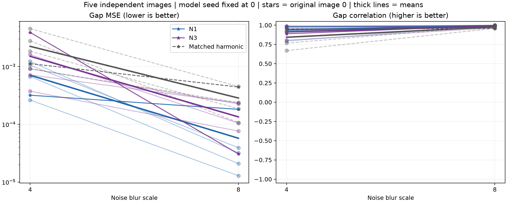
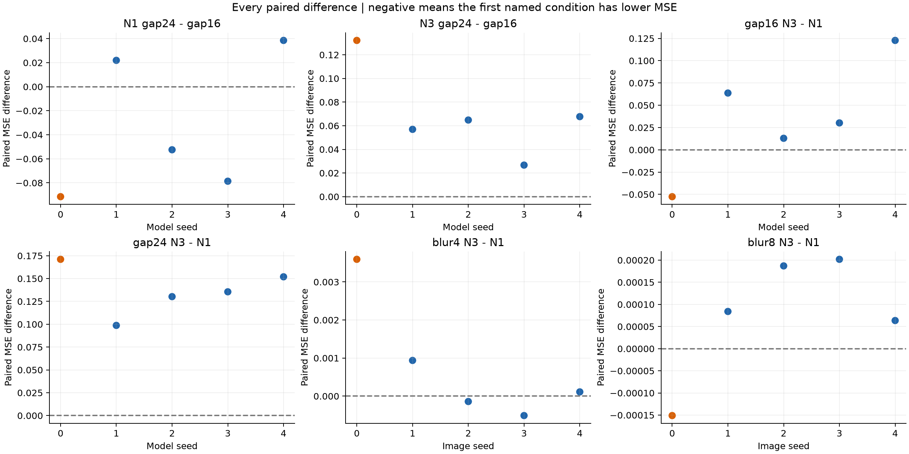
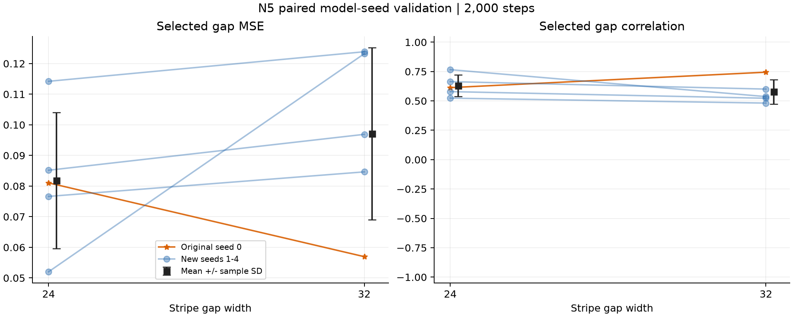
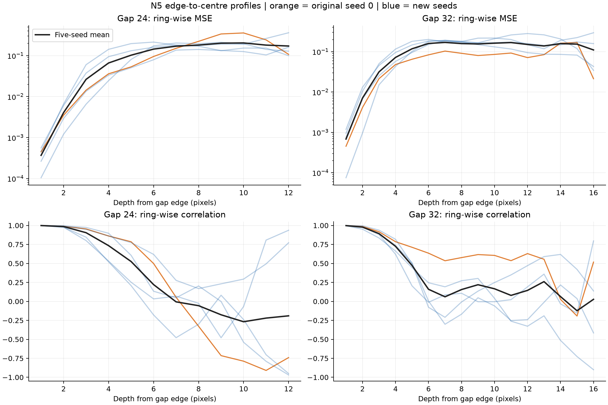

# Local boundary and seed-validation report

**16 November 2026 - 80 local runs**

This follow-up tests the stability of architecture and boundary observations across model initialization/noise seeds and independent blurred-noise targets. It complements the existing eight-network study; it does not replace its results.

## Main results

| Comparison | Observation |
|---|---|
| N1 vs matched harmonic, blur 4 and 8 | N1 lower MSE on 5/5 image seeds at each scale; model seed fixed at zero |
| N3 vs N1, stripe gap 16 | N3 lower only for original seed 0; four new model seeds reverse the ordering |
| N3 vs N1, stripe gap 24 | N1 lower for all five model seeds |
| N3 vs N1, blur 8 | N3 lower only for original image 0; four new images reverse the ordering |
| N5 gap 32 vs 24 | Gap 32 lower only for original seed 0; four new model seeds reverse the ordering |
| N5 edge vs depth 8 | Depth 8 has higher MSE and lower correlation for all five seeds at both gaps |

The non-monotonic N1 gap effect is present in 3/5 model seeds, rather than every seed. Full paired results, new-only summaries and limitations are retained.

See the [protocol, raw-record archive and reproduction instructions](local-boundary-validation-2026-11-16/README.md). Model/training implementations are unchanged from the project source. Gap error never selects the checkpoint; matching the harmonic information set excludes held-out true values.

The original seed-zero observations motivated the follow-ups, so the report separates the four new seeds from the five-seed descriptive summaries. Local CUDA and GitHub CPU results are kept separate. No universal architecture ordering or statistical-significance claim is made.
